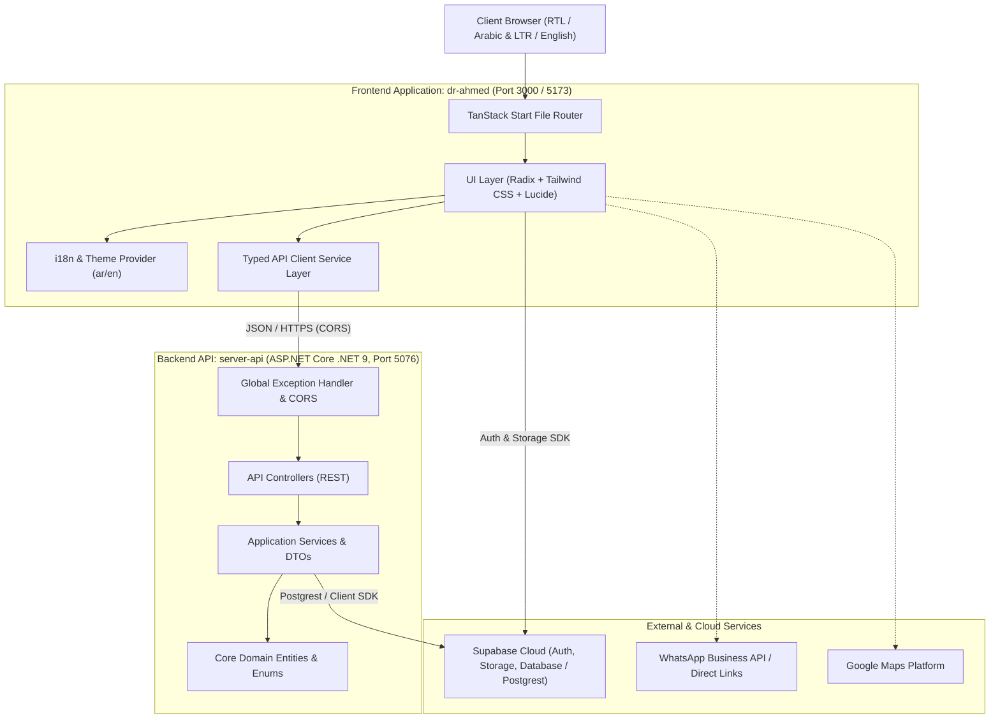

# Solution Architecture Blueprint: Dr. Ahmed Pharmacy

## 1. System Overview

Dr. Ahmed Pharmacy (`صيدلية د. أحمد طارق سليم`) is structured as a decoupled, scalable, modern fullstack solution:



---

## 2. Directory Hierarchy & Clean Separation

```
project-migration-studio-main/
│
├── dr-ahmed/                       # Frontend application (TanStack Start + React 19 + Vite)
│   ├── public/                     # Static public assets (favicons, robots.txt, manifests)
│   ├── src/
│   │   ├── assets/                 # Optimized images & media
│   │   ├── components/             # Reusable UI component library
│   │   │   ├── site/               # Site-specific chrome (Header, Footer, Floating WhatsApp, etc.)
│   │   │   └── ui/                 # Atomic design primitives (Radix UI / Shadcn)
│   │   ├── hooks/                  # Custom React hooks (e.g., use-mobile)
│   │   ├── lib/                    # Core client utilities, i18n, auth context, supabase client, images
│   │   ├── routes/                 # TanStack file-based routing (__root, index, about, services, etc.)
│   │   ├── services/               # API integration client layer (typed REST calls to server-api & Supabase)
│   │   │   └── api/                # Modular service clients (pharmacy, prescription, storage, contact)
│   │   ├── test/                   # Component and route test suites (Vitest + Testing Library)
│   │   ├── types/                  # Shared TypeScript models and API DTO definitions
│   │   ├── utils/                  # Utility helpers and re-exports (supabase, etc.)
│   │   ├── router.tsx              # TanStack router bootstrap
│   │   ├── routeTree.gen.ts        # Auto-generated routing tree
│   │   └── styles.css              # Tailwind v4 styles, variables, typography & layout rules
│   ├── .env                        # Local frontend environment (API + Supabase keys)
│   ├── .env.example                # Frontend environment template
│   ├── package.json                # Frontend package dependencies (@supabase/supabase-js, etc.)
│   ├── tsconfig.json               # TypeScript path alias configuration (@/* -> src/*)
│   └── vite.config.ts              # Vite & TanStack Start build configuration
│
├── server-api/                     # Backend application (ASP.NET Core .NET 9 Web API)
│   ├── Application/                # Application logic, DTOs, and Service Interfaces
│   │   ├── DTOs/                   # Request & Response Data Transfer Objects
│   │   ├── Interfaces/             # Service contracts (IPrescriptionService, IPharmacyService, etc.)
│   │   └── Services/               # Concrete business service implementations
│   ├── Common/                     # Shared envelopes, utilities, and standard API responses
│   │   └── ApiResponse.cs          # Generic ApiResponse<T> envelope
│   ├── Controllers/                # REST Controllers (Todos [Supabase], Prescriptions, Pharmacy, Services, Contact, Health)
│   ├── Core/                       # Core domain layer
│   │   ├── Entities/               # Domain models (PrescriptionRequest, ContactInquiry, PharmacyInfo)
│   │   └── Enums/                  # Enumerations (PrescriptionStatus)
│   ├── Extensions/                 # DI registration (Supabase Client, Application Services, CORS)
│   ├── Middlewares/                # Global exception handler & middleware pipeline
│   ├── Models/                     # Postgrest Supabase Table models (Todo.cs)
│   ├── Properties/                 # Launch profiles & configuration
│   ├── appsettings.json            # Runtime application settings & Supabase config
│   ├── appsettings.Development.json# Development overrides & CORS origins
│   ├── Program.cs                  # ASP.NET Core entry point & pipeline configuration
│   ├── ServerApi.csproj            # .NET 9 Web API (Supabase & Postgrest packages)
│   └── ServerApi.sln               # Solution file for Visual Studio / IDEs
│
├── .agents/skills/                 # AI Agent Skills (Supabase & Postgres best practices)
├── .editorconfig                   # Unified formatting rules (C#, TypeScript, JSON, Markdown)
├── .gitignore                      # Comprehensive git ignore for Node.js and .NET
├── AGENTS.md                       # Agent repository guidelines and architecture constraints
├── ARCHITECTURE.md                 # This architecture blueprint
├── package.json                    # Monorepo root with convenience scripts
└── README.md                       # Quick-start developer guide
```

---

## 3. Frontend Architecture (`dr-ahmed`)

### Scalability Principles
1. **File-Based Routing**: Strict adherence to TanStack Start conventions in `src/routes/`. The shell layout lives in `__root.tsx`, and pages are self-contained route files.
2. **Centralized Domain & Config**: All brand copy, hours, phone numbers, and WhatsApp numbers live in `src/lib/site-config.ts` and `src/lib/i18n.tsx`.
3. **Decoupled API Client**: Located in `src/services/api/`. Views never use ad-hoc `fetch` calls. Instead, components use typed service modules (`pharmacyService`, `prescriptionService`, `contactService`) with automatic base URL injection and error handling.
4. **Bi-directional i18n & Accessibility**: Full Arabic (RTL) first-class support with English (LTR) toggle, synchronized with document direction (`dir="rtl"` vs `dir="ltr"`).

---

## 4. Backend Architecture (`server-api`)

### Clean Architecture Layers
1. **Core / Domain Layer**: Pure domain entities (`PrescriptionRequest`, `ContactInquiry`, `PharmacyInfo`) and enums with no external dependencies.
2. **Application Layer**: Contains contracts (`Interfaces`), DTOs with validation attributes (`[Required]`, `[Phone]`, `[StringLength]`), and business services.
3. **Infrastructure / Persistence Readiness**: Thread-safe in-memory stores with zero external database lock-in, ready to plug in Entity Framework Core (`DbContext`) when a database provider is configured.
4. **Presentation Layer (Controllers)**: Lean REST controllers returning standardized `ApiResponse<T>` envelopes.
5. **Cross-Cutting Pipeline**:
   - `GlobalExceptionHandlerMiddleware` catches unexpected exceptions and formats structured JSON errors.
   - Dynamic CORS policy permitting the frontend ports (`localhost:3000`, `localhost:5173`, etc.).
   - Built-in OpenAPI specification generation.

---

## 5. Standard API Contract

All endpoints follow the unified JSON envelope:

```json
{
  "success": true,
  "message": "Prescription submitted successfully",
  "data": {
    "id": "e4f8d220-4bf6-4b15-9c86-1d129fae155c",
    "patientName": "أحمد إبراهيم",
    "phoneNumber": "+201012345678",
    "status": 0,
    "statusText": "PendingReview",
    "createdAt": "2026-11-06T20:45:00Z"
  },
  "errors": [],
  "timestamp": "2026-11-06T20:45:00.123456Z"
}
```

---

## 6. Development & Operational Commands

| Action | Root Monorepo Command | Folder-Specific Command |
|---|---|---|
| **Run Frontend** | `npm run dev:frontend` | `cd dr-ahmed && npm run dev` |
| **Build Frontend** | `npm run build:frontend` | `cd dr-ahmed && npm run build` |
| **Run Backend API** | `npm run run:backend` | `cd server-api && dotnet run` |
| **Watch Backend API** | `npm run dev:backend` | `cd server-api && dotnet watch` |
| **Build Backend API** | `npm run build:backend` | `cd server-api && dotnet build` |
| **Build Full Stack** | `npm run build` | — |

