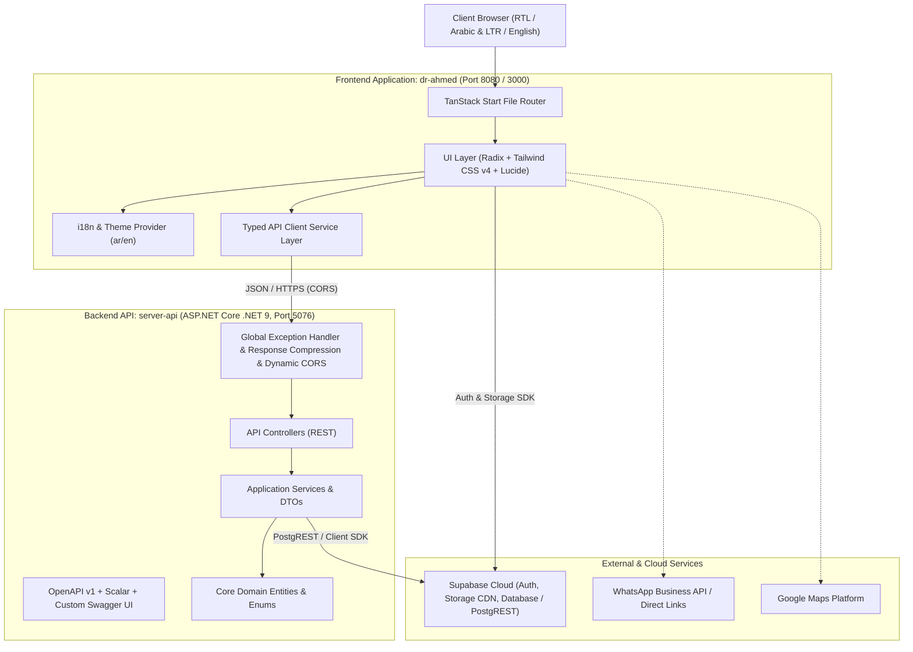

# Solution Architecture Blueprint: Dr. Ahmed Pharmacy

## 1. System Overview

Dr. Ahmed Pharmacy (`صيدلية د. أحمد طارق سليم`) is structured as a decoupled, scalable, modern fullstack solution:



---

## 2. Directory Hierarchy & Clean Separation

```
Pharma-Dr-Ahmed-Eg/
│
├── .github/                        # GitHub Actions CI/CD workflows & issue templates
│   ├── workflows/                  # frontend-ci.yml, backend-ci.yml, release.yml, security-scan.yml
│   ├── ISSUE_TEMPLATE/             # Modern issue forms
│   └── PULL_REQUEST_TEMPLATE.md    # Pull request template
│
├── database/                       # PostgreSQL / Supabase schema, migrations & seed scripts
│   ├── README.md                   # Database architecture guide
│   ├── schema.sql                  # Consolidated database schema
│   ├── supabase-setup-and-seed.sql # Supabase SQL Editor script
│   └── migrations/                 # Incremental SQL migrations
│
├── docs/                           # Central documentation directory
│   ├── ARCHITECTURE.md             # This document
│   ├── API_DOCUMENTATION.md        # Comprehensive REST API reference
│   ├── DEPLOYMENT.md               # Production deployment manual
│   ├── DATABASE.md                 # Detailed schema & RLS guide
│   ├── PERFORMANCE.md              # Optimization & load time benchmark
│   └── ROADMAP.md                  # Strategic product roadmap
│
├── dr-ahmed/                       # Frontend application (TanStack Start + React 19 + Vite)
│   ├── public/                     # Static public assets (favicons, compressed fallback images)
│   ├── src/
│   │   ├── components/             # Reusable UI component library (site/ and ui/)
│   │   ├── hooks/                  # Custom React hooks (use-mobile, use-query, etc.)
│   │   ├── lib/                    # i18n copy, Supabase client, CDN image links, error reporting
│   │   ├── routes/                 # TanStack file-based routing (__root, index, about, services, etc.)
│   │   ├── services/               # API integration client layer (typed REST calls to server-api & Supabase)
│   │   ├── types/                  # Shared TypeScript models and API DTO definitions
│   │   ├── router.tsx              # TanStack router bootstrap
│   │   └── styles.css              # Tailwind v4 styles, variables, typography & layout rules
│   ├── package.json                # Frontend package dependencies (@supabase/supabase-js, etc.)
│   └── vite.config.ts              # Vite & TanStack Start build configuration
│
├── server-api/                     # Backend application (ASP.NET Core .NET 9 Web API)
│   ├── Application/                # Application logic, DTOs, and Service Interfaces
│   ├── Controllers/                # REST Controllers (Pharmacy, Services, Prescriptions, Health)
│   ├── Core/                       # Entities, domain models, and enums
│   ├── Extensions/                 # Service collection extensions (Supabase DI, CORS)
│   ├── Middlewares/                # Global exception handler & middleware pipeline
│   ├── Program.cs                  # ASP.NET Core bootstrap, compression & caching pipeline
│   └── ServerApi.csproj            # .NET 9 project file
│
├── scripts/                        # Utility & operational automation scripts (.mjs)
├── package.json                    # Root monorepo orchestration
├── README.md                       # Root readme with badges & quick start
├── CONTRIBUTING.md                 # Contribution guidelines
├── CHANGELOG.md                    # Release changelog
├── SECURITY.md                     # Security & vulnerability reporting policy
├── CODE_OF_CONDUCT.md              # Contributor Covenant Code of Conduct
└── LICENSE                         # MIT License
```

---

## 3. Technology Stack & Key Libraries

| Component | Technology | Rationale |
|---|---|---|
| **Frontend Framework** | **TanStack Start** (React 19) | Fullstack React with type-safe routing, SSR capabilities, and Nitro deployment engine. |
| **Styling** | **Tailwind CSS v4** | Modern CSS theme variables, fluid responsive grid, native RTL support via CSS logical properties. |
| **Component Primitives** | **Radix UI** + **Lucide Icons** | Accessible headless UI components styled with Tailwind; tree-shakeable icons. |
| **Backend Web API** | **ASP.NET Core (.NET 9)** | Enterprise-grade speed, memory efficiency, native OpenAPI support, and C# type safety. |
| **API Documentation** | **Scalar** + **Swagger UI** | Interactive API exploration at `/scalar/v1` and `/swagger`. |
| **Database & Auth** | **Supabase (PostgreSQL 15)** | Managed Postgres, Row Level Security, Supabase Auth (JWT), and Realtime updates. |
| **Storage & CDN** | **Supabase Storage** | Public edge-cached bucket (`pharmacy-images`) for instant photo delivery. |
| **Performance** | **Brotli/Gzip + HTTP Caching** | Server-level response compression and `[ResponseCache]` for high-concurrency read endpoints. |
