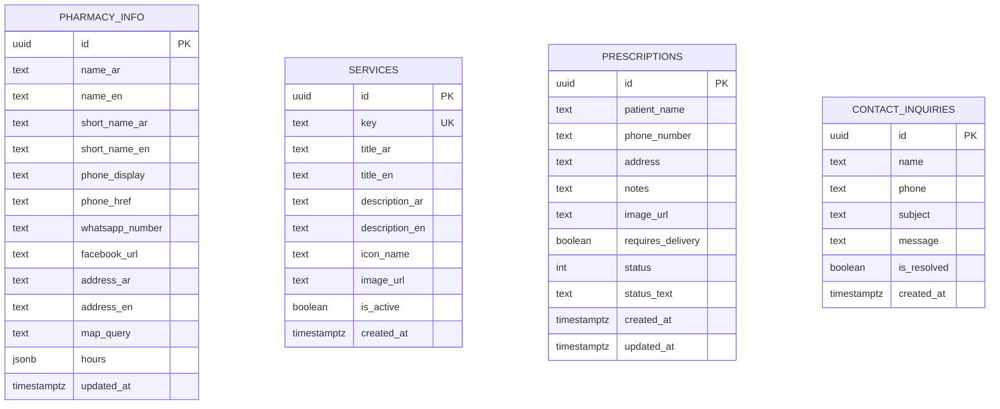

# Database Architecture & Entity Specifications

For the comprehensive database setup guide, migrations, and seed scripts, please see **[database/README.md](../database/README.md)**.

---

## Entity-Relationship Diagram (ERD)

---

## Storage Buckets

1. **`pharmacy-images`**:
   - Access: Public Read (`anon`, `authenticated`)
   - Objects: Brand photos, service visual cards (`medicines.jpg`, `baby-care.jpg`, `delivery.jpg`, etc.).
   - CDN Base URL: `https://jqckzibvkggwfvsdzawa.supabase.co/storage/v1/object/public/pharmacy-images/`

2. **`prescriptions`**:
   - Access: Public Insert (`anon`, `authenticated`), Public Read
   - Objects: Uploaded doctor prescriptions and medical slips.

