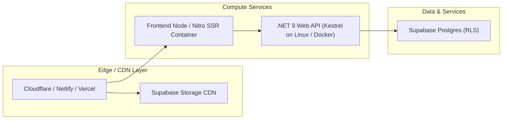

# Production Deployment Guide: Dr. Ahmed Pharmacy

This guide details how to deploy both the **TanStack Start React Frontend** and the **ASP.NET Core .NET 9 Backend Web API** to production environments.

---

## Architecture Overview



---

## 1. Frontend Deployment (`dr-ahmed`)

The frontend is built with **TanStack Start** and uses the **Nitro** server engine under the hood. It can be deployed as a containerized Node.js service, or to modern edge platforms like Cloudflare Pages, Vercel, Netlify, or AWS Amplify.

### Building for Production
```bash
cd dr-ahmed
npm install --frozen-lockfile
npm run build
```
The output is generated in `.output/`:
- `.output/public`: Static assets with immutable cache headers.
- `.output/server`: Nitro server bundle.

### Option A: Node.js / Docker
```dockerfile
FROM node:20-alpine AS runner
WORKDIR /app
COPY dr-ahmed/.output ./
ENV PORT=3000
ENV NODE_ENV=production
EXPOSE 3000
CMD ["node", "server/index.mjs"]
```

### Option B: Cloudflare Pages / Workers
Nitro automatically generates `.output/server/wrangler.json` and Cloudflare-compatible configurations.
```bash
npx wrangler pages deploy .output/public
```

### Environment Variables
Configure the following environment variables in your deployment dashboard:
```env
VITE_SUPABASE_URL=https://jqckzibvkggwfvsdzawa.supabase.co
VITE_SUPABASE_ANON_KEY=your_publishable_anon_key
VITE_API_URL=https://api.your-domain.com
```

---

## 2. Backend Web API Deployment (`server-api`)

The backend is an **ASP.NET Core (.NET 9)** application running high-performance Kestrel.

### Building & Publishing
```bash
cd server-api
dotnet publish -c Release -o ./publish
```

### Option A: Dockerfile (Recommended)
```dockerfile
# Build Stage
FROM mcr.microsoft.com/dotnet/sdk:9.0 AS build
WORKDIR /src
COPY server-api/*.csproj ./
RUN dotnet restore
COPY server-api/ ./
RUN dotnet publish -c Release -o /app/publish /p:UseAppHost=false

# Runtime Stage
FROM mcr.microsoft.com/dotnet/aspnet:9.0 AS final
WORKDIR /app
COPY --from=build /app/publish .
ENV ASPNETCORE_URLS=http://+:5076
ENV ASPNETCORE_ENVIRONMENT=Production
EXPOSE 5076
ENTRYPOINT ["dotnet", "ServerApi.dll"]
```

### Environment Variables & Secrets
Supply these via environment variables or secret managers (Azure KeyVault, AWS Secrets Manager, Doppler):
```env
Supabase__Url=https://jqckzibvkggwfvsdzawa.supabase.co
Supabase__Key=your_publishable_anon_or_service_key
AllowedOrigins__0=https://pharma-dr-ahmed.com
AllowedOrigins__1=https://www.pharma-dr-ahmed.com
```

---

## 3. Database & Storage Deployment

1. Ensure the database schema is up-to-date:
   - Check `database/schema.sql` or apply migrations in `database/migrations/`.
2. Ensure images are uploaded to the public Supabase storage bucket `pharmacy-images`:
   ```bash
   npm run db:upload-images
   ```
3. Run verification check:
   ```bash
   npm run db:verify
   ```

---

## 4. Production Checklist

- [ ] HTTPS enforced on both Frontend and Backend domains.
- [ ] CORS `AllowedOrigins` updated in `appsettings.Production.json` to production domain.
- [ ] Supabase storage bucket `pharmacy-images` set to `public = true`.
- [ ] Compression (Brotli / Gzip) active.
- [ ] Health check monitor configured for `/api/health`.
